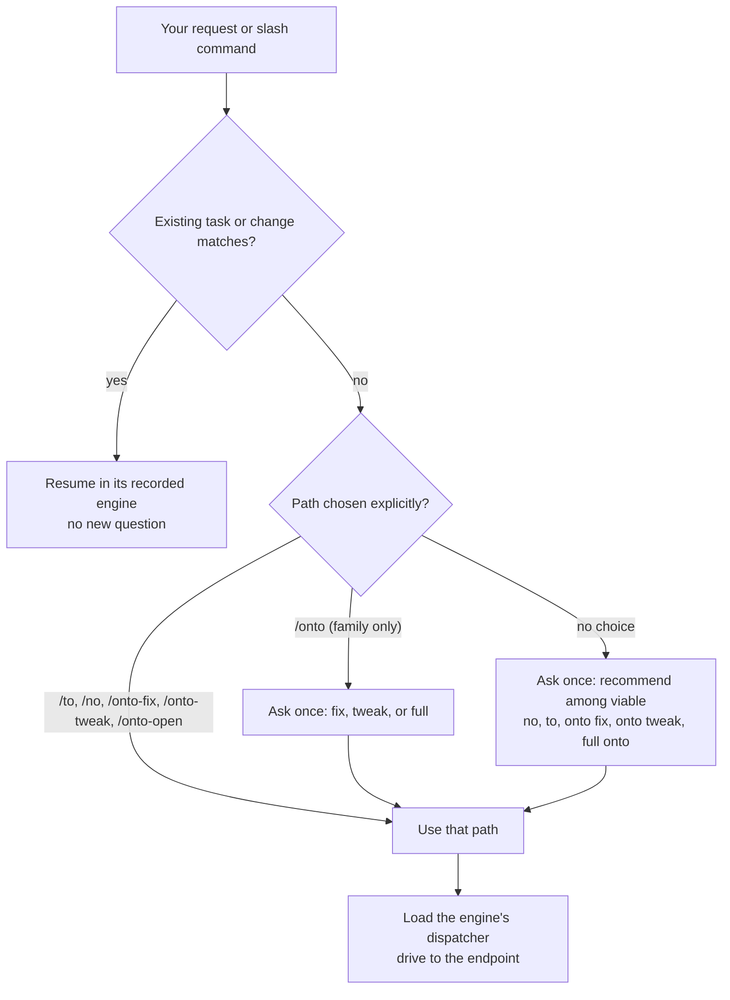

# Workflows — choosing and how they behave

homonto ships three engines and one workflow package. This page compares
them, shows how a request is routed, and describes the behavior they all
share. Each has its own page: [onto](onto-workflow.md), [to](to-workflow.md),
[no](no-workflow.md), [h](h-workflow.md).

## At a glance

| | **onto** | **to** | **no** | **h** |
|---|---|---|---|---|
| Kind | engine | engine | engine | workflow (GitHub) |
| Phases | `open → design → build → verify → close` (+ `fix`, `tweak` presets) | `plan → do → done` | none | per skill |
| Binary | `onto` (owns state, enforces gates) | `to` (owns state, light gates) | — | — |
| Records | `changes/<name>/`: proposal, design, delta specs, tasks, plan, verification, evidence, notes; living `specs/`, `adr/`, `guides/` | `tasks/<name>/plan.md` | none (optional shared task bookkeeping) | none of its own |
| Verification | evidence tokens, scenario evidence, `verify-result`, ≥2 skeptics, receipt-bound integration | real verify + ≥1 skeptic, recorded as a self-asserted `--verified` | model-chosen verification + reviewer | per engine used |
| Best for | work someone else must resume, review, or audit | fast solo/small-team work that still wants real verification | quick implementation + review with no records | issues and PRs on GitHub |
| Cost per change | highest | low | lowest | — |
| Escalation | preset → full onto automatically | none inside a task (start a new onto task) | none | — |

The deciding axis for onto vs. to is **handoff and audit**, not team size: if
someone who wasn't there has to pick the change up or check what was done,
pay for onto.

## How a request is routed



Rules behind the diagram:

- The question is asked **once**, with OpenCode's native question dialog,
  **before** any task is created — never again on resume, after compaction,
  at a phase boundary, or on automatic preset upgrade.
- The recommendation follows inspected scope and risk, not "shortest path".
  A small bug may fit `to` or `onto fix`; both are offered.
- Options that can't be used are excluded with a reason (engine not
  installed, repository policy, preset limit). Answering never installs an
  engine or waives a gate.
- An informational question ("how does onto verify work?") never starts a
  change.

### Preset eligibility

| Path | Fits when | Upgrades to full onto when |
|---|---|---|
| `onto fix` | Broken existing behavior reproducible with a failing test; one module; ≤5 non-test files | >5 non-test files, cross-module, architecture/schema/dependency change, new public API or capability |
| `onto tweak` | Non-bug edit (copy, config, docs, prompts, small feature); one module; ≤5 non-test files; no new capability or changed requirement | same, or a new capability / changed requirement |
| full `onto` | You ask for its record, or design/evidence obligations require it | never downgraded |
| `to` | Bounded work without onto's design/spec/evidence requirements | incompatible scope → asks you; stays `to` |
| `no` | Implementation and review without lifecycle records | incompatible scope → asks you; stays `no` |

Test files and workflow bookkeeping don't count. A security-sensitive change
gets full verification even when a preset still fits.

### One engine per task

All engines can be installed together. A task uses exactly one and keeps it
for its whole life. The coordinator never mixes artifacts or silently
switches engines; if new obligations don't fit the chosen engine, it asks you
for a scope decision. (`to promote` and `onto demote` exist as explicit
manual conversions; see the references.)

## Who does what

```text
                 ┌──────────────────────────────┐
  you ──────────▶│ homonto (coordinator)        │  owns: engine choice, state changes,
                 │ loads onto / to / no / h-*   │  commits, integration, publication,
                 └──────┬───────────────┬───────┘  every question to you
                        │ delegates     │ delegates
          ┌─────────────▼───┐   ┌───────▼──────────────────────────────┐
          │ implementers    │   │ explorers · reviewers · skeptics ·   │
          │ (write code,    │   │ h-spike · h-review                   │
          │ run checks)     │   │ (read-only, many in parallel)        │
          └─────────────────┘   └──────────────────────────────────────┘
```

- Specialists never ask you anything. They return `Questions:` and
  `Evidence requests:`; the coordinator investigates, runs the probe, or asks
  you once.
- Implementers return edits and evidence; the coordinator verifies and
  commits.
- Only the coordinator runs `onto`, `to`, and `homonto` mutations.
- `/no` and the standalone commands run in whatever agent you're using; the
  rest run in `homonto`.

## Shared behavior

These policies live in the shared `homonto` skill and apply to every engine.

### Drive to the endpoint

A command continues through implementation, verification, review triage,
repair, re-verification, archive, integration, and authorized publication in
one invocation. A checked-off task list, a passing test, or a phase boundary
is a checkpoint, not completion. The coordinator returns to you only for:

- the success endpoint;
- an endpoint you named ("plan only", "stop before PR");
- a decision only you can make (product intent, scope, a waiver,
  destructive ambiguity);
- a hard blocker after permitted recovery, reported with evidence and the
  next action.

### Permission blocks come back to the coordinator

When a worker's tool call is denied, or you reject one of its prompts, the
worker stops and returns the exact command and why it needs it. The coordinator
checks whether the action is needed, runs what its own authority covers, and
asks you once about the rest. You can let it run the command, send it the
output or the missing information, continue without it, or change scope. The
work then resumes with a fresh worker. A prompt you rejected is never re-run
without your answer ([ADR 0077](../adr/0077-hand-worker-permission-blocks-to-the-coordinator.md)).

### Decide before asking

Technical choices with safe, reversible defaults are made from repository
evidence: where to work, how to isolate, which checks to run. Questions are
reserved for intent, scope, authorization, and dirty work no earlier answer
covers.

### Explore before guessing

The coordinator dispatches the engine's **explorer** for meaningful
discovery — unfamiliar code before planning, unclear impact before
implementing, disputed finding origin during triage — with independent
questions in parallel and cited answers checked. Trivial, already-grounded
work stays direct.

### Parallel by write scope

Read-only agents run concurrently wherever work is independent. Writers are
limited to **one per checkout**; independent repositories can each have one
implementer at the same time. Workflow-record edits are serial and belong to
the coordinator.

### Dirty work is classified, never swept away

Before writing, the coordinator inspects status, staged and unstaged diffs,
and untracked files, and shows you the exact paths. You choose once:

- **Preserve** — leave edits in place; work around them (clean-tree gates
  still apply).
- **Isolate** — work in a registered worktree from a committed base; the
  dirty checkout is untouched.
- **Specific cleanup** — an approved, named action on named paths.

Nothing is stashed, reset, deleted, committed, or copied (`.env`, secrets)
automatically. The choice carries into delegated tasks and handoffs.

### Review findings are triaged, proportionately

Every skeptic or reviewer finding gets a disposition: repair, evidence probe,
justified dismissal, or a blocking decision for you. Repairs are judged
against **your current request**, including their cumulative size: routine
in-scope repairs proceed without asking; a repair that materially widens
behavior, scope, or risk needs your approval first. For a conflict-resolution
request, only regressions caused by the resolution are in scope. Optional
improvements are recorded as follow-ups. A reviewer's severity label does not
expand the acceptance criteria; real data loss and credential exposure stay
blocking.

### Verification is bound to a candidate

Evidence describes an exact commit. A code change after verification
invalidates the result and the skeptic verdict; both are redone on the new
candidate. Recheck after a repair is bounded to the affected claims and
adjacent risks.

### Publication is explicit

- `h-resolve-issue` and `h-continue-pr` publish (push, PR, summary comment)
  as part of their invocation — but only after verification passes.
- `h-resolve-conflicts` resolves only merge conflicts and authorizes its verified
  same-PR push; no comments, thread resolution or PR merge by default.
- Review comments and spike briefs are posted only after you approve the
  exact draft shown. Shell permission and past approvals are never consent.
- A requested **review-ready PR** means: open, not draft, required checks
  passing on the delivered head, no confirmed in-scope blocking findings.
  Local `done` or a PR receipt alone doesn't prove it.

### Context loss is survivable

All ground truth is on disk: state files, `tasks.md`/`plan.md`, notes, and
evidence. A fresh session re-derives the phase and resumes at the first
unchecked task. `onto handoff`, `to handoff`, `homonto workflow handoff`, and
the OpenCode plugin's compaction context make this fast.

### Finished work is cleaned up by the binaries

After an onto or to change reaches its endpoint, the coordinator reads
`<engine> cleanup list` and previews the generation it just finished. It asks
before `cleanup apply`, and never deletes workflow directories, edits
registries, or force-removes checkouts itself. A blocked cleanup is reported
as blocked. See [cleaning up terminal workflows](workflow-cleanup.md).

## Driving workflows by hand

The binaries work without an agent. That's useful for scripting, CI checks,
and understanding what the coordinator does:

```sh
onto status                      # active onto changes and derived phases
onto gate add-search             # what's blocking, with the exact command
to status --all                  # to and onto changes together
homonto workflow snapshot --json # both workflows, machine-readable
onto doctor --quiet; echo $?     # exit status only, for hooks
homonto workflow cleanup list    # what finished work can be cleaned up
```

## Further reading

- [onto workflow](onto-workflow.md) · [onto reference](onto-reference.md)
- [to workflow](to-workflow.md) · [to reference](to-reference.md)
- [no engine](no-workflow.md)
- [h GitHub workflow](h-workflow.md)
- [Principles](principles.md) — YAGNI and KISS as the skills apply them
